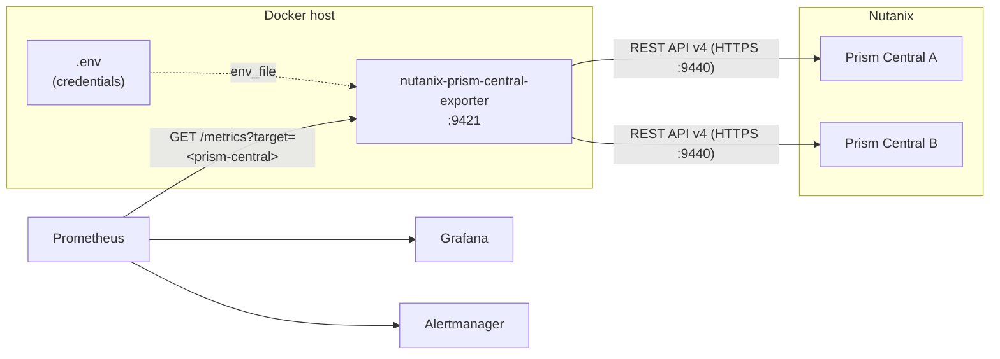

# nutanix-prism-central-exporter

A lightweight Prometheus exporter for **Nutanix Prism Central**, based on the **v4 REST APIs**.

- Single Python file, **standard library only** (no dependencies)
- **Multi-target**: one exporter instance serves any number of Prism Central
- **Auto-discovery**: AOS clusters and hosts are discovered from each Prism Central, nothing to declare per cluster
- Cluster capacity and performance, fault tolerance, host state and maintenance, open alerts

## Architecture



The exporter never pushes data and holds no target list: **Prometheus pulls the metrics** and tells the exporter which Prism Central to query through the `target` parameter, like the Blackbox or SNMP exporters.

## Requirements

- Prism Central exposing the v4 APIs (`clustermgmt/v4.0`, `monitoring/v4.0`)
- A **read-only** Prism Central account (for example with the Viewer role), created with the same credentials on every Prism Central you want to monitor
- Docker with the Compose plugin (or Python 3.9+ for the systemd mode)
- A Prometheus server able to reach the exporter

## Quick start

**1. Configure and start the exporter**

```bash
git clone https://github.com/<owner>/nutanix-prism-central-exporter.git
cd nutanix-prism-central-exporter
cp .env.example .env && chmod 600 .env    # then set PRISM_USER / PRISM_PASSWORD
docker compose up -d --build
```

Check it can reach a Prism Central:

```bash
curl -s "localhost:9421/metrics?target=<prism-central-fqdn>" | grep nutanix_up
# nutanix_up 1
```

**2. Add the scrape job to Prometheus** (see below)

**3. Reload Prometheus.** Metrics start flowing on the next scrape.

## Prometheus configuration

The file [`examples/prometheus.yml`](examples/prometheus.yml) is **not read by the exporter container**. It is a snippet for your own Prometheus server. Add it in one of two ways:

- copy the job under `scrape_configs:` in your `prometheus.yml`, or
- drop the file as is in a directory loaded with `scrape_config_files:` (Prometheus 2.43 or later).

Then adapt two things:

```yaml
    static_configs:
      - targets:
          - prism-central-a.example.com     # your Prism Central (port 9440 implied)
          - prism-central-b.example.com
    relabel_configs:
      - source_labels: [__address__]
        target_label: __param_target        # becomes ?target=...
      - source_labels: [__param_target]
        target_label: instance              # instance label = the Prism Central
      - target_label: __address__
        replacement: nutanix-prism-central-exporter:9421   # where Prometheus reaches the exporter
```

`replacement` must be an address Prometheus can actually reach: the container name works only if Prometheus and the exporter share a Docker network, otherwise use `<host-ip>:9421`.

Adding a Prism Central only requires a new entry in `targets` and a Prometheus reload: the exporter does not need to be restarted.

A collection takes a few seconds per Prism Central, so keep a generous `scrape_timeout` (the example uses a 60 s interval and a 45 s timeout).

## Configuration

All settings are environment variables, read from `.env` by Docker Compose.

| Variable | Default | Description |
|---|---|---|
| `PRISM_USER` | *(required)* | Prism Central account, shared by all targets |
| `PRISM_PASSWORD` | *(required)* | Password of this account |
| `PRISM_EXPORTER_PORT` | `9421` | Listening port inside the container |
| `PRISM_TIMEOUT` | `20` | Timeout of each API call, in seconds |
| `PRISM_CA_FILE` | *(unset)* | CA bundle used to verify Prism Central certificates |

Values in `.env` must not be quoted: Docker does not strip quotes.

### TLS

Without `PRISM_CA_FILE`, certificates are **not verified**, which suits the self-signed certificates Prism Central ships with. To enable verification, put your CA certificate next to `docker-compose.yml` as `ca.pem`, uncomment the `volumes` section of the compose file, and set:

```
PRISM_CA_FILE=/etc/nutanix-prism-central-exporter/ca.pem
```

## Endpoints

| Path | Description |
|---|---|
| `/metrics?target=<prism-central>` | Collects and returns the metrics of one Prism Central. The target is a FQDN or IP, with an optional `:port` (default 9440) |
| `/health` | Liveness probe, returns `200 ok` without calling Prism Central. Used by the Docker healthcheck |

Any other request returns `400`.

## Metrics

All metrics are gauges. Labels added by Prometheus (`job`, `instance`) are not shown.

### Collection status

| Metric | Labels | Description |
|---|---|---|
| `nutanix_up` | | 1 if Prism Central responded with at least one AOS cluster |
| `nutanix_cluster_stats_up` | `cluster` | 1 if the cluster statistics were retrieved |
| `nutanix_alerts_up` | | 1 if the alerts were retrieved |

### Clusters

| Metric | Labels | Description |
|---|---|---|
| `nutanix_cluster_info` | `cluster`, `aos_version`, `ncc_version` | Software versions (always 1) |
| `nutanix_cluster_available` | `cluster` | 1 if Prism Central sees the cluster as available |
| `nutanix_cluster_nodes` | `cluster` | Number of nodes |
| `nutanix_cluster_vms` | `cluster` | Number of VMs |
| `nutanix_cluster_redundancy_factor` | `cluster` | Redundancy factor (RF) |
| `nutanix_cluster_fault_tolerance` | `cluster`, `state` (`current`/`desired`) | Number of node failures tolerated |
| `nutanix_cluster_operation_mode` | `cluster`, `mode` | Operation mode (always 1) |
| `nutanix_cluster_upgrade_status` | `cluster`, `status` | Last upgrade status (always 1) |
| `nutanix_cluster_hypervisor_version` | `cluster`, `version` | Hypervisor version(s), several during a rolling upgrade (always 1) |
| `nutanix_cluster_cpu_usage_ratio` | `cluster` | Hypervisor CPU usage (0-1) |
| `nutanix_cluster_memory_usage_ratio` | `cluster` | Hypervisor memory usage (0-1) |
| `nutanix_cluster_memory_usage_bytes` | `cluster` | Memory used |
| `nutanix_cluster_storage_usage_bytes` | `cluster` | Physical storage used |
| `nutanix_cluster_storage_capacity_bytes` | `cluster` | Physical storage capacity |
| `nutanix_cluster_storage_free_bytes` | `cluster` | Physical storage free |
| `nutanix_cluster_storage_logical_usage_bytes` | `cluster` | Logical storage used (before data reduction) |
| `nutanix_cluster_controller_iops` | `cluster`, `op` (`total`/`read`/`write`) | Controller IOPS |
| `nutanix_cluster_controller_latency_seconds` | `cluster`, `op` (`total`/`read`/`write`) | Controller average I/O latency |
| `nutanix_cluster_health_check_score` | `cluster` | Prism health check score, raw value as returned by the API |

Statistics are the latest point of a 10-minute window queried at each scrape.

### Hosts

| Metric | Labels | Description |
|---|---|---|
| `nutanix_host_info` | `cluster`, `host`, `hypervisor_state`, `maintenance_state`, `hypervisor_version`, `ip` | States and version (always 1) |
| `nutanix_host_vms` | `cluster`, `host` | Number of VMs on the host |
| `nutanix_host_maintenance` | `cluster`, `host` | 1 if the host or its CVM is in maintenance |
| `nutanix_host_up` | `cluster`, `host` | 1 if the host is connected and not in maintenance |

### Alerts

| Metric | Labels | Description |
|---|---|---|
| `nutanix_cluster_alerts` | `cluster`, `severity` (`critical`/`warning`/`info`) | Open (unresolved) alerts per cluster |
| `nutanix_pc_alerts` | `severity` | Open alerts of Prism Central itself, not tied to a cluster |

## Running without Docker (systemd)

An example unit is provided in [`examples/systemd/`](examples/systemd/nutanix-prism-central-exporter.service). It runs the script with an ephemeral unprivileged user (`DynamicUser`) and reads the same variables from an environment file:

```bash
install -D -m 0755 prism_exporter.py /opt/nutanix-prism-central-exporter/prism_exporter.py
install -D -m 0600 .env /etc/nutanix-prism-central-exporter/nutanix-prism-central-exporter.env
cp examples/systemd/nutanix-prism-central-exporter.service /etc/systemd/system/
systemctl daemon-reload && systemctl enable --now nutanix-prism-central-exporter
```

## Limitations

- One account for all targets: per-target credentials are not supported.
- Up to 100 clusters per Prism Central and 100 hosts per cluster are listed.
- Up to 1,000 open alerts per Prism Central are counted.

## License

See [LICENSE](LICENSE).
